<div align="center">
    <picture>
        <source media="(prefers-color-scheme: dark)" srcset="assets/logo-on-dark.svg">
        <source media="(prefers-color-scheme: light)" srcset="assets/logo-primary.svg">
        
    </picture>
    <h1>🫂 SharedOPS</h1>
    <p><em>A shared home, a clearer plan.</em></p>
</div>

SharedOPS helps couples organize household responsibilities and tasks. Partners can see who owns a responsibility, what needs doing and who has taken a task.

## Project status

The project is in active development. The repository contains the Spring Boot backend foundation, development tooling and smoke tests. Household workflows and the web frontend are still planned.

| Stage                   | Planned scope                                                                                                                                                        |
| ----------------------- | -------------------------------------------------------------------------------------------------------------------------------------------------------------------- |
| M0 — Coordination Pilot | Accounts and sessions, two-person households, individual responsibilities, one-off tasks and checklists, English/Ukrainian/German interface, deployment and recovery |
| M1                      | Shared responsibilities, recurring tasks, Lists, Task–List references, Activity and Home views                                                                       |
| M2                      | Expenses, budgets, settlements and financial history across partner changes                                                                                          |
| M3                      | Further product extensions defined in the requirements inventory                                                                                                     |
| M4                      | Optional Android client                                                                                                                                              |

The [requirements inventory](docs/requirements.md) assigns individual requirements to stages. The [toolchain verification record](docs/evidence/toolchain-verification.md) describes what has actually been checked.

## Requirements

- **JDK 25 LTS**, without preview features. Set `JAVA_HOME` to this JDK and use Java 25 in the IDE, Maven importer and Maven runner.
- **Node.js 22.12.0 or newer**, with Corepack available.
- **pnpm 12.14.0**, selected through Corepack and `package.json`.
- **pre-commit 4.0.0 or newer**.
- A running **Docker-compatible runtime** for Testcontainers and the test development launcher.
- **PostgreSQL 18** for running against a separately managed database.

Maven is supplied by the committed Maven Wrapper. Exact dependency and tool versions are listed in the [technology stack](docs/stack.md).

## Setup

Run commands from the repository root:

```bash
java -version
node --version
corepack pnpm --version
pre-commit --version
make setup
```

`make setup` installs JavaScript tooling from the lockfile and installs both pre-commit and commit-msg hooks. Hooks may format files; review and restage any changes before committing. Commit messages use Conventional Commits, for example `docs: update setup instructions`.

## Run the backend

For the current backend foundation, the test development launcher starts PostgreSQL through Testcontainers. Start Docker, then run:

```bash
cd backend
./mvnw spring-boot:test-run -Dspring-boot.run.arguments=--spring.flyway.locations=classpath:db/persistence-smoke
```

The migration location above contains test fixtures. Use this launcher to inspect the backend foundation, not to store household data. Product endpoints and production migrations are still pending. Spring Security currently uses its default development authentication; the planned account/session workflow is not implemented.

To use a separately managed PostgreSQL database, copy `backend/config/application-local.example.properties` to `backend/config/application-local.properties` and fill in the datasource, server and logging values. The local profile loads this file from `backend/config/`; it is ignored by Git. From the repository root:

```bash
make backend-run
```

Production schema migrations and complete application configuration must be added as their features are implemented. A frontend launch command is available in the Makefile, but requires the planned `web/` application.

## Checks

| Command             | Purpose                                                                                        |
| ------------------- | ---------------------------------------------------------------------------------------------- |
| `make format`       | Apply Java and supported text formatting                                                       |
| `make format-check` | Check formatting                                                                               |
| `make check`        | Check formatting and Java static rules                                                         |
| `make test`         | Run Surefire tests, including the context and Modulith checks                                  |
| `make verify`       | Run backend verification, Failsafe integration tests, static checks and text formatting checks |
| `make hooks-check`  | Run file hooks; may apply formatting                                                           |

Some `make test` checks start PostgreSQL through Testcontainers, so Docker is required for that command as well as `make verify`. Commit-msg validation runs separately when committing.

## Repository layout

```text
assets/        Project logos
backend/       Spring Boot application, Maven Wrapper, configuration and tests
docs/          Requirements, decisions, stack, risks, test strategy and evidence
Makefile       Development and verification commands
package.json   Pinned JavaScript formatting and commit-message tooling
```

The React/TypeScript frontend will live in `web/` when introduced.

## Documentation

Start with the [documentation index](docs/readme.md), then use the [technology stack](docs/stack.md), [requirements inventory](docs/requirements.md), [product decision register](docs/decision-register.md), [risk register](docs/risk-register.md) and [test strategy](docs/test-strategy.md).
