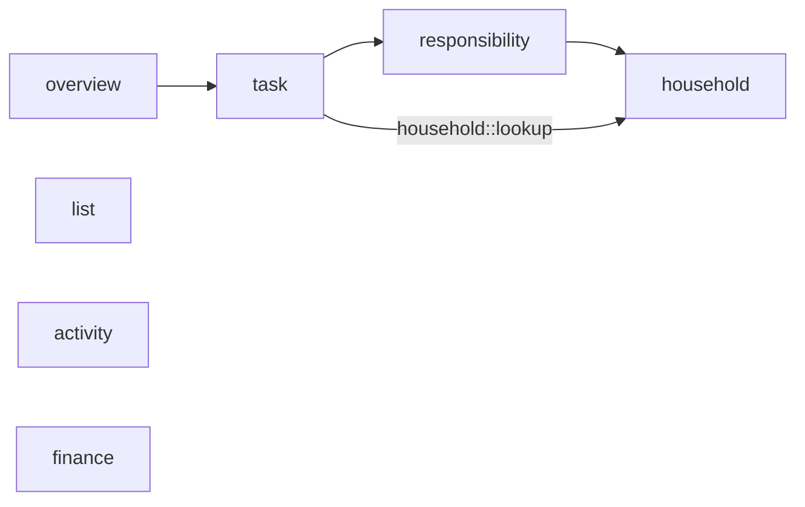

# SharedOPS Backend Architecture

> **Scope:** HO-005 — Enforce modular architecture boundaries  
> **Status:** M0 architecture baseline (28 October 2026)  
> **Base package:** `dev.sharedops`

## 1. Overview

SharedOPS is a **modular monolith** built with Java, Spring Boot, and Spring Modulith. The backend is organized around business capabilities rather than technical layers shared across all features.

Seven functional modules are declared using `@ApplicationModule` and discovered with the explicitly annotated detection strategy (`spring.modulith.detection-strategy=explicitly-annotated`):

| Business module  | Responsibility                                              | Allowed module dependencies           |
| ---------------- | ----------------------------------------------------------- | ------------------------------------- |
| `household`      | Households; planned account and authentication capabilities | None                                  |
| `responsibility` | Responsibilities within households                          | `household`                           |
| `task`           | Task management                                             | `responsibility`, `household::lookup` |
| `overview`       | Aggregated task overview                                    | `task`                                |
| `list`           | Lists                                                       | None                                  |
| `activity`       | Activity-related functionality                              | None                                  |
| `finance`        | Financial functionality                                     | None                                  |

`common` and `config` are supporting packages, **not** additional functional modules. The table documents the **currently permitted dependency graph**, not a claim that all those calls have already been implemented.

## 2. Allowed module dependencies



An arrow points **from a consuming module to a module it is permitted to depend on**. The diagram represents `@ApplicationModule(allowedDependencies = ...)` declarations and may include dependencies not yet exercised by production code.

The permitted dependency set is intentionally narrow. Dependencies should be added or changed only alongside an explicit feature requirement and an architecture review.

## 3. Internal layers

The intended package structure within each feature module is:

```text
dev.sharedops.<module>/
├── domain/          # Domain model, value objects, domain errors and rules
├── application/     # Application use cases and, when needed, ports
├── api/             # External HTTP controllers and request/response types
└── infrastructure/  # Persistence and other technical adapters
```

Not every directory needs to contain a concrete implementation at the M0 scaffolding stage.

The enforced dependency rules are:

| Source              | Restriction                                                                                                                                                    |
| ------------------- | -------------------------------------------------------------------------------------------------------------------------------------------------------------- |
| `domain`            | Must not depend on `application`, `api`, or `infrastructure`                                                                                                   |
| `domain`            | Must not depend on prohibited frameworks (including Spring, Jakarta, Hibernate, or Jackson)                                                                    |
| `application`       | Must not depend on `api` or `infrastructure`                                                                                                                   |
| `api`               | Must not depend directly on `infrastructure`                                                                                                                   |
| Other modules       | Must not depend on another module's `infrastructure.persistence`                                                                                               |
| Module repositories | Must reside in their module's `infrastructure.persistence` package; this includes Spring Data repositories, `@Repository` types, and types named `*Repository` |

Infrastructure adapters may implement ports defined by the application layer. HTTP controllers should call application use cases, not persistence implementations. Domain exceptions must remain independent of HTTP representations and HTTP error mapping.

## 4. Public module contracts

**Module interfaces are not HTTP APIs.** HTTP-facing types live in `<module>.api`; cross-module Java contracts may be exported explicitly through Spring Modulith `@NamedInterface`.

The initial contract is `household::lookup`:

```text
dev.sharedops.household/
├── contract/
│   └── HouseholdLookup.java    # Named interface "lookup"
└── domain/
    └── HouseholdId.java        # Domain value object
```

`HouseholdLookup` declares `boolean existsById(HouseholdId id)`. The interface is annotated with `@NamedInterface(value = "lookup", propagate = true)`, so `HouseholdId` remains in `household.domain` while also being included in the exported `lookup` interface. The domain type is not annotated with Spring annotations.

`task` permits `household::lookup` rather than an unrestricted `household` dependency, while its existing `responsibility` permission remains unchanged. The contract declares a boundary; a concrete lookup implementation is **not** part of HO-005.

Other cross-module interfaces should be introduced when a use case requires them, not preemptively for all modules.

## 5. Automated architecture verification

The intended architecture gate includes:

| Test                                            | Purpose                                                                                                                 |
| ----------------------------------------------- | ----------------------------------------------------------------------------------------------------------------------- |
| `ModularityTest`                                | Detect exactly seven business modules; validate Spring Modulith boundaries with `ApplicationModules.verify()`           |
| `ModularityTest.exportsHouseholdLookupContract` | Verify that `household::lookup` contains both `HouseholdLookup` and `HouseholdId`                                       |
| `ArchitectureRulesTest`                         | Enforce domain/framework independence, repository placement, persistence isolation, and domain/application/API layering |
| `ArchitectureRulesContractTest`                 | Exercise negative and positive scenarios with test-scope fixtures                                                       |

Spring Modulith verification checks **existing code dependencies**. A green result does not, by itself, prove that every prohibited dependency has been deliberately exercised in a negative test.

Run the configured Maven verification lifecycle from the backend directory:

```bash
./mvnw verify
```

## 6. Maintenance and scope

- Keep `@ApplicationModule(allowedDependencies = ...)` declarations and the diagram in Section 2 synchronized.
- Keep domain value objects and domain exceptions free of HTTP and framework concerns; map them to HTTP responses in the API layer.
- Place account and authentication capabilities within `household` when those features are implemented, as specified by HO-005.
- Review module exports when implementing new cross-module use cases; avoid direct cross-module repository access.

**Completion check for HO-005:** successful full Maven verification and confirmation that the diagram and package structure match the repository at the time of completion.
